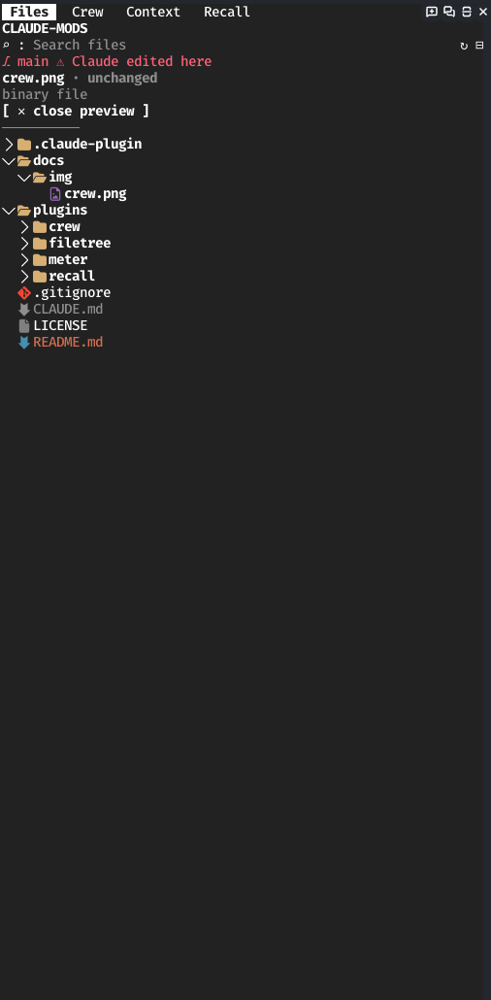
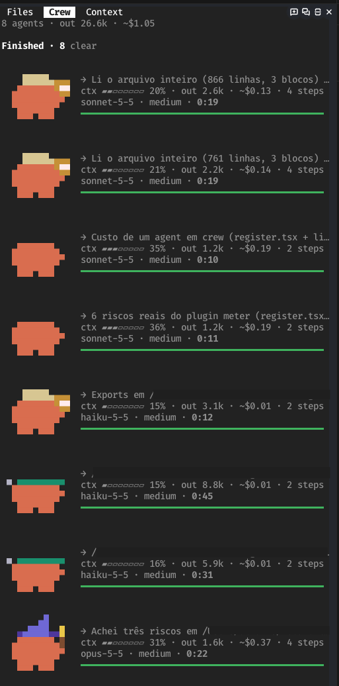
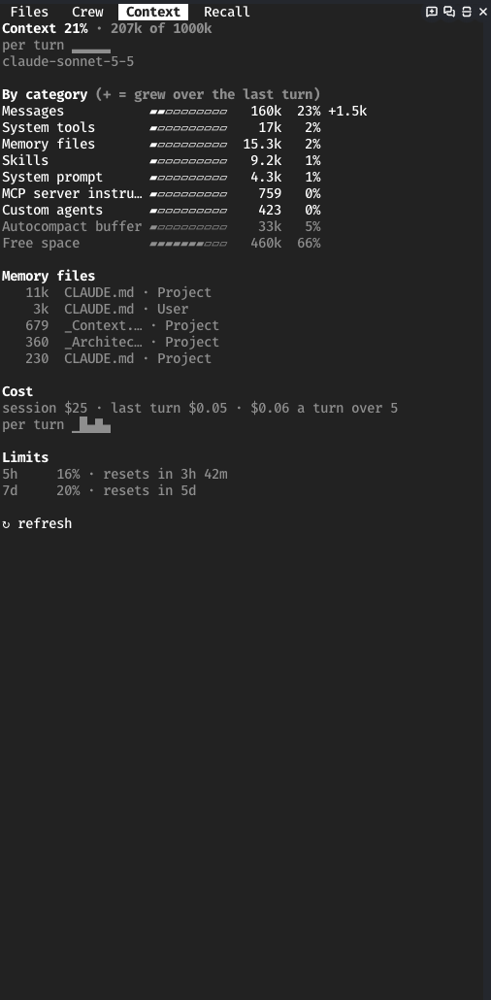
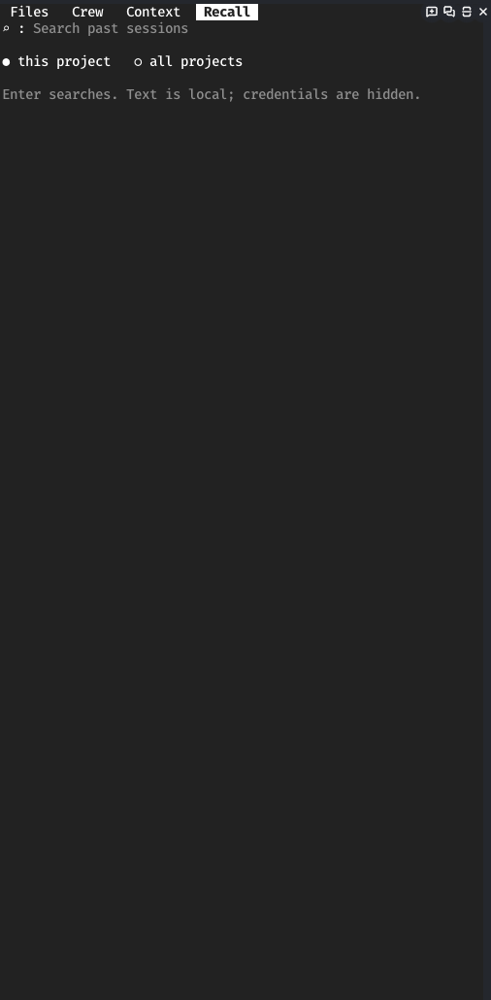

# claude-mods

Marketplace pessoal de mods para o Claude Code. Cada recurso é um plugin independente em `plugins/`, para que uma falha em um não derrube os outros. Código aberto, contribuições bem-vindas: veja [CONTRIBUTING.md](CONTRIBUTING.md).

## Plugins

| Plugin | Versão | O que faz | Origem |
|---|---|---|---|
| `filetree` | 0.7.3 | Painel de árvore de arquivos: pastas sob demanda, busca, prévia paginada (diff ou conteúdo) ao clicar, nomes coloridos pelo estado no git, arquivos que o Claude lê e escreve, alerta de arquivo sensível, aviso de edição em `main` ou sobre mudança sua não commitada e, opcional, PR/CI/review do GitHub via `gh` | Próprio |
| `crew` | 0.3.1 | Painel de subagents (`/crew`): um card por agent com caranguejo animado, papel, ferramenta atual, resposta, contexto, tempo e custo estimado (`~$`) | Próprio; arte do crab-band (MIT), ver aviso abaixo |
| `meter` | 0.1.4 | Contexto e custo da conversa principal: painel `/meter` com a janela por categoria, o que cada turno acrescentou, custo por turno e limites; aviso único quando o contexto passa de `warnAt` | Próprio |
| `recall` | 0.1.0 | Busca no texto das sessões passadas (`/recall <palavras>`): este projeto ou todos, com o id para `claude --resume` | Próprio |

## Como é

Os painéis abrem como abas ao lado do chat (`/filetree`, `/crew`, `/meter`, `/recall`). Depois de um `/reload-plugins` as abas fecham e precisam ser reabertas pelo comando.

### filetree



A árvore do projeto com pastas sob demanda e busca. A linha da branch (`main`) avisa quando o Claude editou algo (`⚠ Claude edited here`). Clicar num arquivo abre a prévia no topo: diff contra o HEAD se há mudança, senão o início do conteúdo (aqui, um binário só avisa). Nomes em laranja foram tocados pelo Claude, em cinza são ignorados pelo git, e amarelo, verde e vermelho seguem o estado no git.

### crew



Um card por subagent. O caranguejo muda de fantasia conforme o tipo do agent (Haiku, Sonnet, Opus, Explore…) e dança enquanto ele roda. A linha com `→` é a primeira linha da resposta; `ctx` é o medidor de contexto; `~$` é o custo estimado pela sua tabela `prices`; o total da sessão fica no topo (`8 agents · out 26.6k · ~$1.05`).

### meter



A aba `Context`: quanto da janela está usada, a janela por categoria (com `+N` do que cada uma cresceu no último turno), os maiores arquivos de memória, o custo da sessão e por turno, e os limites de 5 h e 7 d com o tempo para resetar. O botão `↻ refresh` relê o engine.

### recall



Caixa de busca no histórico das sessões passadas; `this project` ou `all projects` troca o escopo. Cada resultado traz data, projeto, o `claude --resume <id>` e até 3 trechos. O print acima é o estado inicial, antes de uma busca.

## Instalar

Registre o marketplace uma vez e instale só os mods que quiser, um `install` por mod:

```
claude plugin marketplace add Alfafis/claude-mods
claude plugin install filetree@alfafis-mods
claude plugin install meter@alfafis-mods
claude plugin install recall@alfafis-mods
claude plugin install crew@alfafis-mods
```

Para atualizar: `claude plugin marketplace update alfafis-mods`. Para desenvolver a partir de uma cópia local, use o caminho no lugar do repo: `claude plugin marketplace add /caminho/para/claude-mods`.

**Segurança:** cada mod roda código na sua máquina, em hooks de toda chamada de ferramenta. Leia o código antes de instalar e fixe a versão se quiser evitar mudanças. Vulnerabilidades: veja [SECURITY.md](SECURITY.md).

Depois de instalar ou mudar o código, `/reload-plugins`. Opções (`/plugin configure <plugin>@alfafis-mods`) só valem depois de reiniciar o Claude Code.

## Opções

| Plugin | Opção | Padrão | Efeito |
|---|---|---|---|
| `filetree` | `autoOpen` | ligado | abre o painel no início de toda sessão; desligado, só com `/filetree` |
| `filetree` | `icons` | `nerd` | `nerd` (exige Nerd Font), `dot` ou `none` |
| `filetree` | `github` | desligado | consulta PR, checks e review da branch via `gh` |
| `filetree` | `githubRefreshSeconds` | 300 | intervalo mínimo entre consultas |
| `crew` | `autoOpen` | ligado | abre o painel no primeiro subagent |
| `crew` | `maxCards` | 30 | limite suave de cards, nunca descarta agent rodando |
| `crew` | `compactFinished` | desligado | concluído em 2 linhas, sem caranguejo |
| `crew` | `groupByParent` | ligado | agent aninhado sob quem o criou |
| `crew` | `contextWindow` | 200000 | tamanho da janela, em tokens, usado no medidor de contexto de cada card (8000 a 2000000) |
| `crew` | `prices` | vazio | JSON de preços por modelo (USD por milhão de tokens); sem ele não há `~$` |
| `meter` | `autoOpen` | ligado | abre o painel `Context` no início de toda sessão; desligado, só com `/meter` |
| `meter` | `band` | desligado | linha de contexto e custo acima do prompt |
| `meter` | `limits` | ligado | janelas de 5 h e 7 d na linha e no painel |
| `meter` | `warnAt` | 80 | % de contexto que dispara o aviso (50 a 95) |
| `recall` | `scope` | `project` | `project` ou `all` (todas as pastas de `~/.claude/projects`) |

## O que cada um não faz

- `crew`: o custo é estimativa a partir da tabela `prices` e do `usage` de cada step, não a fatura. Escrita de cache com TTL de 1 h custa o dobro e o `usage` não separa o TTL; faixas de preço por tamanho de prompt não são modeladas.
- `meter`: o percentual e a janela são os da compactação (o que dispara o autocompact), que pode ser menor que a janela do modelo; nesse caso o painel avisa. Cost e limites vêm do engine. Limites só existem em assinatura. A compactação não aparece como queda por categoria.
- `recall`: só lê o histórico local, em macOS e Linux. Usa o ripgrep embutido no binário do Claude Code (`ARGV0=rg`, detalhe interno que pode mudar) e `rg` do PATH como reserva. Credenciais são mascaradas por heurística; o escopo `all` mostra texto de outros projetos.
- `filetree`: git sempre com `--no-optional-locks` e sem fsmonitor, para não travar o commit do Claude nem executar código de config de repo clonado.

## Aviso sobre o `crew`

O caranguejo vem do [crab-band](https://github.com/MaxHarfen/crab-band) (MIT), que declara ser desenhado a partir do Clawd, mascote do Claude Code da Anthropic, sem apoio da Anthropic. A MIT cobre a obra dos autores, não o personagem: direitos sobre o Clawd continuam com a Anthropic, e este projeto não é afiliado nem apoiado por ela. Se o titular pedir, a arte é removida ou trocada. Detalhes em `plugins/crew/NOTICE.md`.

## Convenções

- Um plugin por recurso, com `.claude-plugin/plugin.json` próprio.
- Estado da engine é do plugin dono: o nome do plugin entra nas chaves de `$.state`.
- Código vindo de terceiros mantém licença e crédito originais dentro da pasta do plugin.
- Teste e validação: `claude plugin validate plugins/<nome>` e `claude plugin test plugins/<nome>` (o `bun test` direto não roda: falta o módulo da engine).
